# Architecture: Collibra Edge Enterprise Lab

A small, fake "bank" that runs on one laptop, built to show **how a bank would use Collibra Edge** to understand and govern its data, without that data ever leaving the bank.

> **Real vs conceptual:** everything in this lab runs for real, *except* Collibra Edge and the Collibra Catalog. They need an x86 Linux server and a Collibra subscription, so their part is documented, not deployed.

---

## 1. The big picture

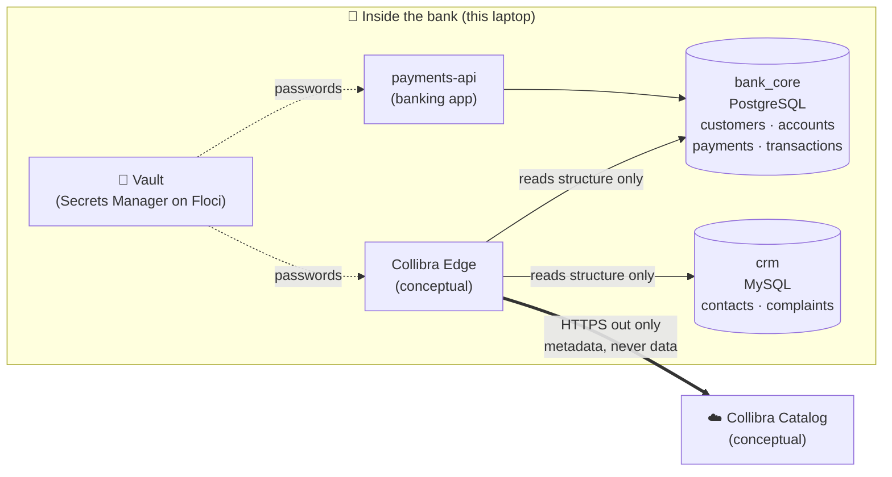

**In one sentence:** the app writes data into the bank's databases. Collibra Edge, sitting inside the bank, reads only the *description* of that data (tables, columns, tags) using a password from the vault, and sends that description out to Collibra.

---

## 2. The building blocks

| Layer | What | Technology | Status |
|---|---|---|---|
| **Data** | Core banking DB + CRM DB with ~270k fake rows | PostgreSQL 17, MySQL 8.4 | ✅ real |
| **Application** | Payments microservice | Python FastAPI, Docker image | ✅ real |
| **Platform** | Mini data centre running everything | Kubernetes (k3d / k3s) | ✅ real |
| **Cloud** | Vault, encryption keys, storage, queues | Floci (AWS emulator) | ✅ emulated |
| **Automation** | Build infrastructure and deploy apps from code | Terraform, Helm, Kustomize, scripts | ✅ real |
| **Governance** | Discover, classify and trace data | Collibra Edge + Catalog | 📄 conceptual |
| *Coming next* | CI/CD, monitoring, failure drills | GitHub Actions, Argo CD, Prometheus/Grafana | ⏳ |

### How it is laid out inside Kubernetes

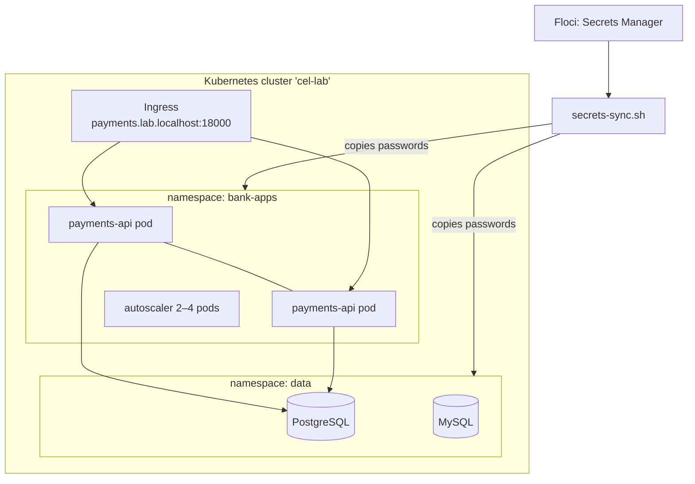

### Database accounts: one per job (least privilege)

| Account | Used by | Can see structure | Can read data | Can change data |
|---|---|---|---|---|
| `collibra_ingest` | Edge: cataloguing | ✅ | ❌ | ❌ |
| `collibra_profile` | Edge: profiling / PII detection | ✅ | ✅ | ❌ |
| `bank_app` | payments-api | ✅ | ✅ | payments only |
| `bank_migrator` | schema changes | ✅ | ✅ | structure |

---

## 3. Use cases

Each use case answers: **who** needs it, **what** they want, **how** it flows, and **how to try it**.

### Use case 1: A customer makes a payment
**Who:** a customer, via the bank's app. **Goal:** move money and record it reliably.

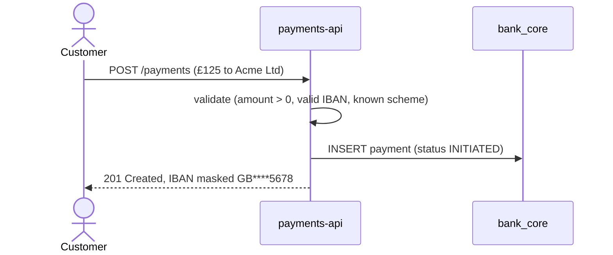
**Try it:**
```bash
curl -X POST http://payments.lab.localhost:18000/api/v1/payments -H 'content-type: application/json' \
  -d '{"debtor_account_id":2,"creditor_name":"Acme Ltd","creditor_iban":"GB29SYNT99000112345678","amount":"125.00","currency":"GBP","scheme":"FPS"}'
```
**Status:** ✅ real

---

### Use case 2: "Where is our customer data?" (catalogue the databases)
**Who:** the data governance team. **Goal:** an inventory of every table and column, so data has an owner and a definition.

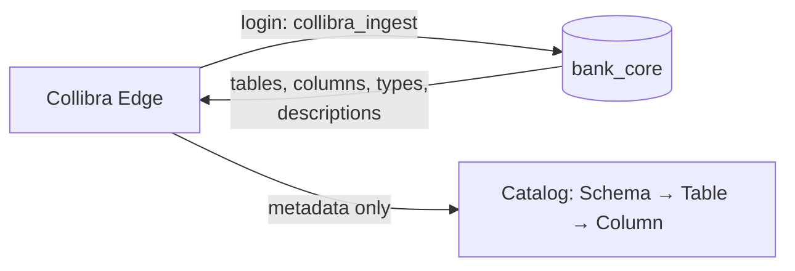
What Edge would see (real output from the lab):
```
first_name                | [PII-DIRECT] Given name.
national_insurance_number | [PII-DIRECT] UK National Insurance number.
date_of_birth             | [PII-INDIRECT] Date of birth.
```
**Try it:** `scripts/demo-usecase.sh` (step 3)
**Status:** ✅ the access and visibility are real. The Collibra side is 📄 conceptual.

---

### Use case 3: Catalogue without exposing customers (least privilege)
**Who:** the security and data protection officer. **Goal:** governance tools must not become a back door to personal data.

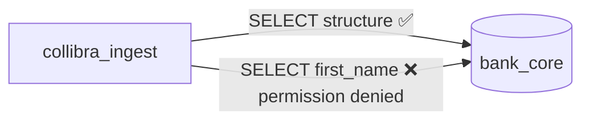
**Try it:** `scripts/demo-usecase.sh` (step 4) or `scripts/db-verify.sh` (28 checks)
**Status:** ✅ real

---

### Use case 4: Find personal data copied across systems ("PII sprawl")
**Who:** the Data Protection Officer (UK GDPR). **Goal:** know *every* place a customer's personal data lives, so it can be protected, minimised or deleted on request.

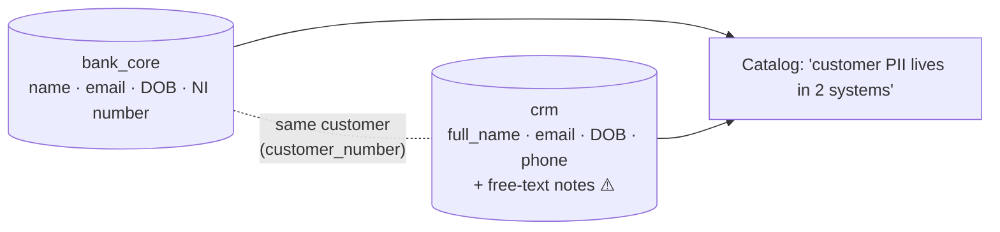
**Try it:** `scripts/demo-usecase.sh` (step 5)
**Status:** ✅ the duplicated data is real. Automatic classification is 📄 conceptual.

---

### Use case 5: Trace a report back to its sources (lineage)
**Who:** Financial Crime / an auditor. **Goal:** "This alert came from which tables and columns?"

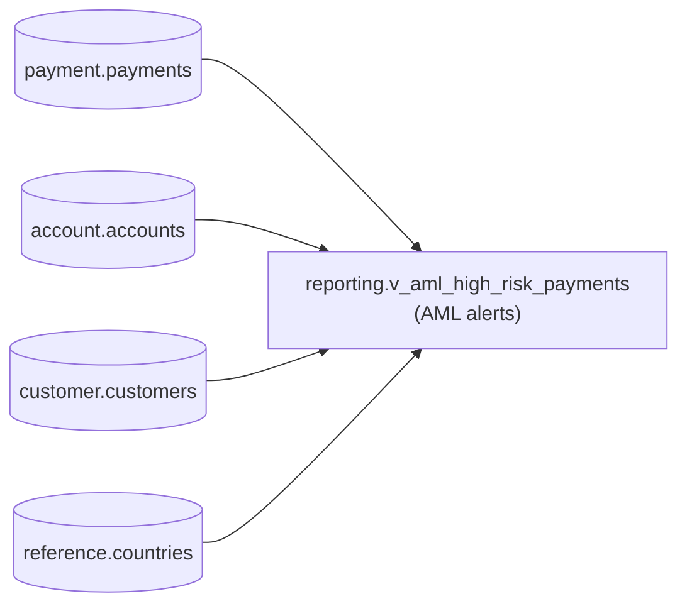
A £12,500 payment by a high-risk customer appears in the AML report straight away. The SQL behind the report is also published to the `lineage-sql` bucket, where a lineage tool would read it.
**Try it:** `scripts/demo-usecase.sh` (steps 1–2)
**Status:** ✅ the report and its source tables are real. The lineage diagram in Collibra is 📄 conceptual.

---

### Use case 6: Change a password without breaking anything
**Who:** the security team (regular rotation, or after a suspected leak). **Goal:** new password everywhere, old one dead, no outage, and no password ever stored in code.

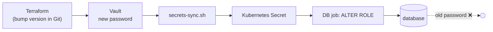
**Try it:** in `infrastructure/terraform/envs/lab/lab.tfvars` set `"bank-core-pg/collibra_profile" = 2`, then:
```bash
scripts/tf.sh lab plan -out=tfplan && scripts/tf.sh lab apply tfplan
scripts/db-load.sh && scripts/db-verify.sh
```
**Status:** ✅ real (vault emulated)

---

### Use case 7: Release a new app version safely, and roll back
**Who:** the platform / DevOps team. **Goal:** deploy without downtime, and undo a bad release in one command.

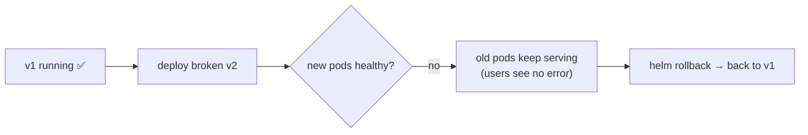
**Try it:**
```bash
helm --kube-context k3d-cel-lab -n bank-apps history payments-api
helm --kube-context k3d-cel-lab -n bank-apps rollback payments-api <REVISION>
```
**Status:** ✅ real (proven: the API stayed at HTTP 200 during a failed release)

---

### Use case 8: Rebuild the whole environment from code
**Who:** platform team / disaster recovery. **Goal:** recreate everything from Git, no manual clicks.

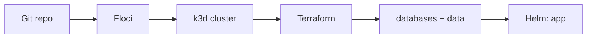
**Try it:** follow "Build it from scratch" in [LAB-GUIDE.md](../LAB-GUIDE.md) (~10 min).
**Status:** ✅ real. Data regenerates byte-for-byte identically.

---

## 4. How Collibra Edge would fit in a real bank

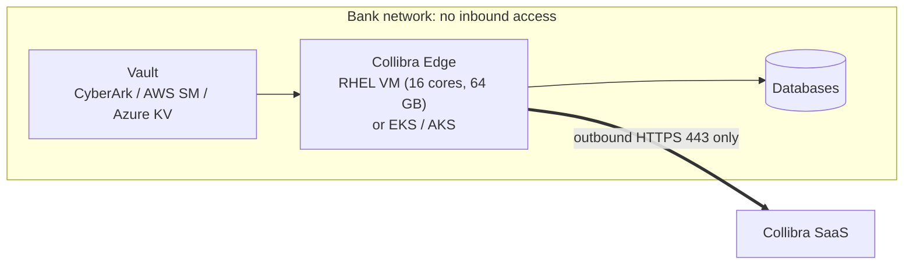

| Lab | Real bank |
|---|---|
| k3d on a laptop | Dedicated RHEL VM (bundled k3s) or managed Kubernetes |
| Floci "AWS" | Real AWS / Azure, or an on-prem vault like CyberArk |
| Synthetic data | Real data, with the same least-privilege accounts |
| Edge documented | Edge installed, registered and connected to the tenant |

---

## 5. Where to go next
- **Use it:** [LAB-GUIDE.md](../LAB-GUIDE.md) · one-command demo: `scripts/demo-usecase.sh`
- **Details per phase:** `docs/phase-*.md` and `docs/installation/`
- **What changed on the laptop, and how to undo it:** [PROGRESS-LOG.md](../PROGRESS-LOG.md)
