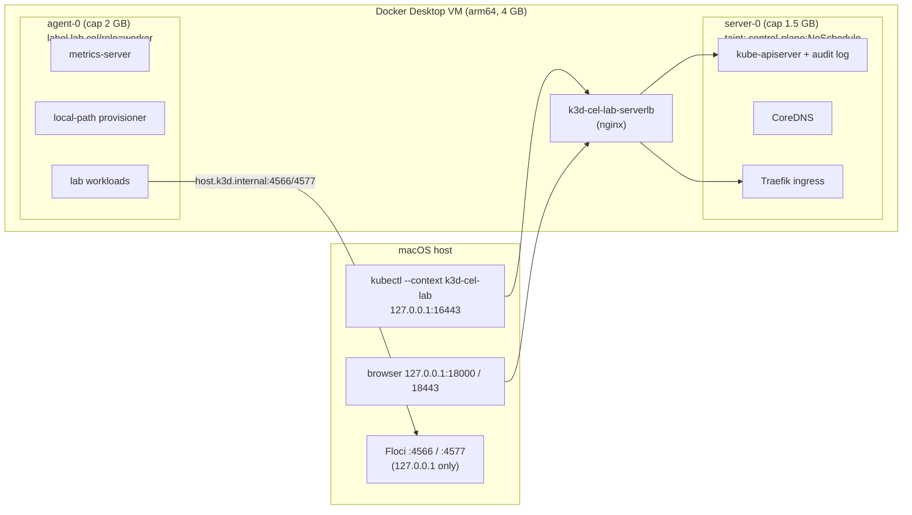

# Phase 3 — Local Platform Setup

**Date:** 2026-11-11 · **Status:** ✅ Complete and verified · **Approved by user:** "All prep steps"

| Step | Result |
|---|---|
| 3.1 Reclaim disk | Free space 19 → **23 GB** (build cache 2.6 GB + dangling images). Tagged images and volumes untouched |
| 3.2 Pause other stacks | `other-project-a` (13 containers) and `other-project-b` (4) stopped cleanly. Volumes intact. ≈1.7 GB RAM freed |
| 3.3 Docker Desktop Kubernetes | Disabled (`settings.json` backed up). Port 6443 freed |
| 3.4 Tooling | kubectl 1.37.2, Terraform 1.17.2, gh, yq, trivy, argocd, psql 18.6 |
| 3.5 Repository | `git init -b main`, skeleton, secret-safe `.gitignore`, README |
| 3.6 Cluster | k3d **cel-lab**: k3s v1.36.6, 1 control plane + 1 worker, audit logging on |
| 3.7 Floci | **24/24 smoke tests passed** from the host. Pods reach Floci via `host.k3d.internal` |

---

## 3.1 Reclaiming disk space

**What:** `docker builder prune -af` (BuildKit layer cache) and `docker image prune -f` (dangling `<none>` images only).
**Why:** at 96% disk full, the next large image pull could fail mid-write and corrupt Docker's VM disk.
**Internals:** Docker Desktop stores everything in one sparse disk file (`Docker.raw`). Pruning frees blocks inside the VM, and Docker Desktop then returns them to macOS (TRIM). That's why the host gain (4 GB) arrived gradually. Dangling images are layers no tag points to, left behind each time you rebuild `myapp:dev`.
**Enterprise:** CI runners and Kubernetes nodes hit the same issue. The kubelet runs **image garbage collection** at `imageGCHighThresholdPercent` (default 85%), and a node under `DiskPressure` evicts pods. In Collibra Edge terms: `/var/lib/kubelet` needs ≥200 GB precisely because job images and lineage scratch space fill it.
**Troubleshooting:** a prune that "reclaims 0B" while the image count drops means the images were held by the build cache, so pruning the builder released them.

## 3.2 Pausing other stacks
**What:** `docker stop -t 30/60`, applications first and databases last.
**Why:** the lab's budget is the Docker VM's 4 GB.
**Internals:** `docker stop` sends **SIGTERM**, waits for the timeout, then sends SIGKILL. Postgres treats SIGTERM as a "smart shutdown": it checkpoints the WAL and exits cleanly. Restart policy `unless-stopped` remembers a *manual* stop, so these stay down even after Docker restarts.
**Restore later:**
```bash
docker compose --project-directory <other-project-a-dir> start
docker compose --project-directory <other-project-b-dir> start
```

## 3.3 Disabling Docker Desktop Kubernetes
**What:** set `"kubernetesEnabled": false` in `~/Library/Group Containers/group.com.docker/settings.json` (backup: `settings.json.bak-2026-11-11`), then restart Docker Desktop 4.27.2.
**Why:** it was unhealthy (EOF on :6443) and was using RAM and the 6443 port.
**What happened:** the first relaunch fired while the old instance was still shutting down, so macOS ignored it. A second `open -a Docker` worked. Floci restarted on its own (`unless-stopped`). Its Azure emulator keeps state in memory, so the old `azsmoke` test container disappeared, as expected.
**Revert:** tick Settings › Kubernetes › *Enable Kubernetes*, or restore the backup file.

## 3.4 Tooling

| Tool | Version | Used in |
|---|---|---|
| kubectl | 1.37.2 | everywhere |
| Terraform | 1.17.2 (`hashicorp/tap`) | Phase 5 |
| gh / yq / trivy / argocd | 2.103.3 / 4.54.3 / 0.76.2 / 3.6.1 | Phases 7–8 |
| psql | 18.6, keg-only: `/opt/homebrew/opt/libpq/bin/psql` | Phase 4 |
| tflint | **not installed** (no longer in Homebrew core). It will run in GitHub Actions | Phase 8 |

**Version skew, an interview favourite:** kubectl is supported within **±1 minor** of the API server. Homebrew ships kubectl 1.37, so the cluster runs **k3s 1.36** (not the cached 1.35). 1.36 is also the newest line Collibra lists for bundled Edge sites.
**Why Terraform moved taps:** HashiCorp changed Terraform's licence to BSL in Aug 2023. Homebrew core froze at 1.5.7 (the last MPL release), and current releases come from HashiCorp's tap. OpenTofu is the open-source fork, if a bank's policy forbids BSL.

## 3.5 Repository
`git init -b main`, plus the structure from the brief and a `.gitignore` that blocks state files, `.env`, keys, kubeconfigs and Collibra installer artefacts (`edge-secret.yaml`, `registries.yaml`, `proxy.properties`). It was written **before** any secret exists. `.terraform.lock.hcl` *is* committed, because it pins provider versions and checksums (a supply-chain control).

## 3.6 The k3d cluster

### What and why
A **local Kubernetes cluster defined as code** (`kubernetes/cluster/k3d-cel-lab.yaml`), created with `scripts/lab-up.sh`.
Analogy: k3d is a dolls' house. Each "node" is a Docker container running a full k3s, so you get real nodes, scheduling, networking and storage at toy scale.

### Architecture


### Design decisions

| Decision | Reason | Production equivalent |
|---|---|---|
| 1 server + 1 agent | Shows control-plane vs worker separation and node drain/failure, at minimum RAM | 3 control planes (HA etcd) + N workers across AZs |
| Control-plane **taint** | App pods can't land on the control plane | Standard on EKS/AKS (managed control plane) and kubeadm |
| Memory caps (1.5/2 GB) | The lab can never starve Floci or macOS | Node sizing + `ResourceQuota`/`LimitRange` |
| API on `127.0.0.1:16443` | Not reachable from the LAN | Private API endpoint (EKS private cluster) |
| `switchCurrentContext: false` | Never silently retarget kubectl (you also have a **real AKS context**) | Separate kubeconfigs per environment, `kubectx` guard rails |
| **Audit policy** | Who read secrets, who changed RBAC, who exec'd into a pod | Mandatory in banking (SOX/PCI): ship to a SIEM |
| k3s 1.36, pinned image | Reproducible, inside the skew policy | Version pinning + upgrade cadence |

### Expected output (verified)
```
NAME                   STATUS   ROLES           VERSION
k3d-cel-lab-agent-0    Ready    <none>          v1.36.6+k3s1
k3d-cel-lab-server-0   Ready    control-plane   v1.36.6+k3s1
```
System pods: coredns, traefik, metrics-server, local-path-provisioner, svclb, all Running. The `helm-install-traefik*` jobs show `Completed`, which is normal: k3s installs Traefik through a one-shot Helm job. StorageClass `local-path (default)` uses **WaitForFirstConsumer**: the volume is created on whichever node the pod is scheduled to. `kubectl top nodes` works. The audit log was written (959 events in the first minute).
**Footprint:** server ≈790 MB, agent ≈300 MB, LB ≈35 MB.

### Troubleshooting
| Symptom | Likely cause | Check |
|---|---|---|
| `kubectl` → connection refused :16443 | Cluster stopped | `k3d cluster list`, `scripts/lab-up.sh` |
| Node `NotReady` | Node container OOM-killed (cap reached) | `docker inspect k3d-cel-lab-server-0 -f '{{.State.OOMKilled}}'` |
| Pods `Pending` with "untolerated taint" | Pod expected on the control plane | Correct: it belongs on the worker. Check agent capacity |
| Pods `Pending`, "Insufficient memory" | Requests exceed 2 GB on the agent | `kubectl describe node k3d-cel-lab-agent-0` → Allocated resources |
| No audit log | Policy file not mounted | Created without `lab-up.sh`? Recreate with the script |
| zsh: "flags cannot be placed before plugin name" | `$VAR` holding flags isn't word-split in zsh | Write flags literally, or use an array |

## 3.7 Floci validation
`infrastructure/floci/smoke-test.sh` (re-runnable) uses dummy creds with `AWS_CONFIG_FILE=/dev/null`, so real `~/.aws` can't be read.

| Service | Result | Classification |
|---|---|---|
| S3 (SSE, versioning), SQS, KMS, Secrets Manager (JSON field + rotation), SSM, CloudWatch Logs, IAM | ✅ functional | **Emulated, functional** |
| RDS, EKS | ✅ API answers (describe/list) | **API-level only.** Not used to host anything |
| Azure Blob, Queue, Key Vault secrets | ✅ functional | **Emulated, functional** (Key Vault: `http://127.0.0.1:4577/devstoreaccount1-keyvault`) |
| Pod → Floci | ✅ `http://host.k3d.internal:4566` and `:4577` | In-cluster endpoint for later phases |

Floci AWS state persists in `~/floci/data`. Floci Azure state is **in memory**, so Terraform for Azure resources must be re-applied after a Floci restart (we'll design Phase 5 for that).

---

## Interview preparation
**Q1. Why put a NoSchedule taint on the control plane, and how do system add-ons still run there?**
A taint repels pods that lack a matching **toleration**. It protects the API server and etcd from noisy neighbours, which matters because if the control plane is starved, the whole cluster loses its brain. Critical add-ons (CoreDNS, Traefik in k3s) carry tolerations, so they still schedule there. Taints *repel*, tolerations *permit*, and affinity *attracts*. They are different tools.

**Q2. What is the kubectl version-skew policy and why does it matter in a bank?**
kubectl must be within one minor version of the API server. Outside that, fields can be silently dropped or rejected. Banks upgrade clusters in waves (dev → UAT → prod), so engineers need tool versions per environment, pinned in CI images.

**Q3. What do you put in a Kubernetes audit policy for a regulated environment?**
Metadata-level logging for Secrets (record *who* accessed them, never the *values*). Request-level logging for RBAC changes. Always log `pods/exec`, `attach` and `port-forward`. Drop health-check and watch noise. Ship logs off-cluster to a tamper-evident SIEM with retention that meets the regulator's rules.

## Knowledge checkpoint
1. Your Secrets audit rule uses `Metadata`, not `RequestResponse`. What would go wrong if it were `RequestResponse`?
2. A pod calls `http://localhost:4566` and gets "connection refused", yet `curl localhost:4566` works on your Mac. Why, and what should the pod use?
