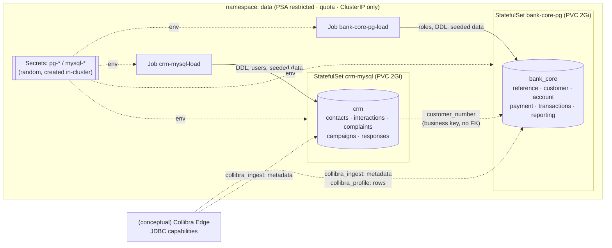
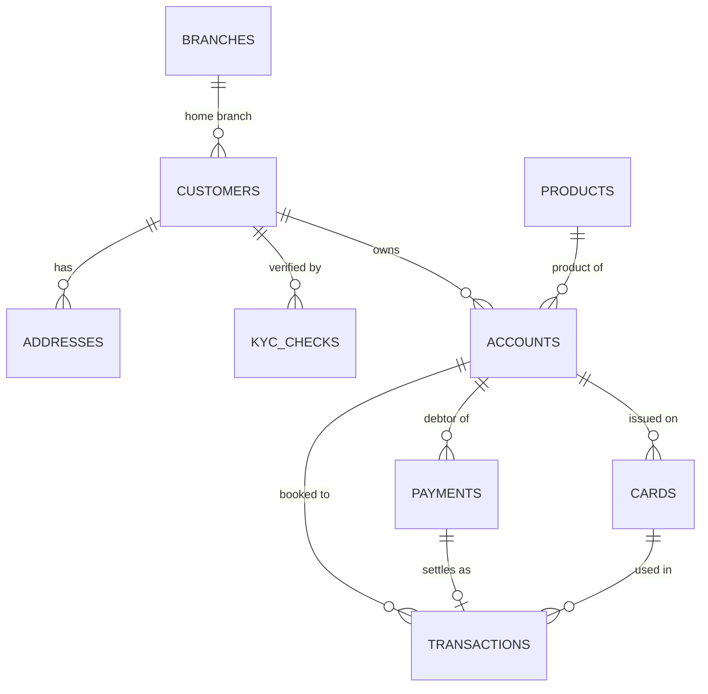
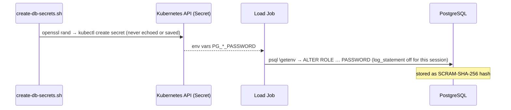

# Phase 4 — Synthetic Bank Data Tier

**Date:** 2026-11-11 · **Status:** ✅ Deployed and verified (`scripts/db-verify.sh`: 28/28, data regenerates byte-identically)

| Item | Result |
|---|---|
| Namespace `data` | Pod Security **restricted**, ResourceQuota, LimitRange, **no NodePort/LoadBalancer allowed** |
| PostgreSQL 17.11 `bank_core` | 6 schemas, 11 tables, 4 views, ~230k rows, 55 MB |
| MySQL 8.4.13 `crm` | 5 tables, 1 view, ~37k rows. Duplicates customer PII on purpose |
| Roles | Least privilege per purpose: **metadata-only** vs **profiling** vs application |
| Credentials | Random, generated in-cluster, never on disk / argv / Git / server logs |
| Reproducibility | Seeded SQL generators: two regenerations → identical hashes on all 11 tables |

Everything in this phase is **real** (running databases, real privileges). The Collibra side, i.e. which Edge capability would use which role, is **conceptual** (Option B).

---

## 1. What are we doing, and why?
A bank's data governance team needs to *discover* what data exists, *where* the PII is, and *how* data flows. Before any catalog can do that, you need realistic sources. We built two:

- **`bank_core` (PostgreSQL)**: the system of record: customers, KYC, accounts, cards, payments, ledger.
- **`crm` (MySQL)**: a separate CRM owned by another team, which **copies** customer PII and links back only by a business key (`customer_number`), with no enforced foreign key. This "PII sprawl" is exactly what Collibra's catalog, classification and lineage exist to expose.

## 2. Architecture


## 3. Data model (bank_core)


| Schema | Tables / views | Rows | Sensitive columns (tagged in comments) |
|---|---|---|---|
| reference | currencies, countries, branches, products | 42 | — |
| customer | customers, addresses, kyc_checks | 5,000 / 6,000 / 9,546 | names, NI number, email, phone [PII-DIRECT]; DOB, postcode [PII-INDIRECT] |
| account | accounts, cards | 7,962 / 4,625 | IBAN [PII-INDIRECT]; masked PAN, token [PCI] |
| payment | payments | 40,000 | creditor name/IBAN; amount [FINANCIAL] |
| transactions | transactions | 159,433 | amount [FINANCIAL] |
| reporting | v_customer_360, v_daily_payment_volumes, v_aml_high_risk_payments, v_account_monthly_activity | views | derived: **lineage targets** |

**Why the views matter:** `v_aml_high_risk_payments` joins payments → accounts → customers → countries. A lineage tool (Collibra's *Technical Lineage for PostgreSQL*, conceptual here) parses that SQL and draws column-level arrows, so an auditor can ask "which source columns feed the AML alert?"

**Synthetic by construction (verified, not just claimed):**

| Data | Rule | Why it can never be real |
|---|---|---|
| NI numbers | `QQnnnnnnX` | HMRC never issues the QQ prefix |
| Email | `@example.com/.org/.net` | RFC 2606 reserved domains |
| Phone | `+44 7700 900xxx` | Ofcom's drama range |
| IBAN | `GBkk SYNT …`, **valid mod-97** | Fictitious bank code. Valid checksum so validators behave realistically |
| Foreign IBAN | `XX00SYNT…` | Check digits `00` never occur in a real IBAN |
| Cards | `400000******1234` + token | Test BIN, masked. **No full PAN anywhere** (PCI DSS scope reduction) |
| Sort codes | `99xxxx` | Not used by real banks in this lab |

## 4. What happens internally

### StatefulSet vs Deployment
A Deployment treats pods as interchangeable cattle. A database pod is a pet: it needs a **stable identity** (`bank-core-pg-0`), **its own disk** that follows it (via `volumeClaimTemplates` → PVC `data-bank-core-pg-0`), and **ordered** start/stop. The headless Service (`clusterIP: None`) gives it a stable DNS name: `bank-core-pg-0.bank-core-pg-hl.data.svc.cluster.local`.

### Probes
| Probe | Command | Purpose |
|---|---|---|
| startup | `pg_isready` every 3 s × 60 | Gives initdb up to 3 min **before** liveness can kill it |
| readiness | `pg_isready` | Not ready → removed from Service endpoints (no traffic) |
| liveness | `pg_isready`, 6 failures | Wedged → restart |

### Configuration as content-hashed ConfigMaps
Kustomize turns `*.sql` and `mysql-lab.cnf` into ConfigMaps named like `crm-mysql-config-7hth88kcdd`. Edit the file and the hash changes, the StatefulSet template changes, and Kubernetes **rolls the pod automatically**. That removes the classic "changed the ConfigMap but the pod still runs old config" incident.

### Credentials flow

- **Not in argv:** `psql \getenv` and MySQL `--defaults-extra-file` (written to a memory-backed `emptyDir` with `umask 077`).
- **Not in DB logs:** the bootstrap does `SET log_statement='none'` before `ALTER ROLE … PASSWORD`, because the server logs all DDL. The verify script checks the log.
- **Rotation:** delete or update the Secret and re-run `scripts/db-load.sh`. The bootstrap re-applies passwords from the Secrets.
- Phase 5 moves the source of truth to **Floci Secrets Manager / Key Vault** in the exact format an Edge vault integration reads.

## 5. Least privilege, mapped to Collibra Edge capabilities

| Role | Edge capability it represents (conceptual) | Can see metadata | Can read rows | Can write |
|---|---|---|---|---|
| `collibra_ingest` (PG + MySQL) | **Catalog JDBC ingestion** | ✅ | ❌ | ❌ |
| `collibra_profile` (PG) | **JDBC Profiling**, **Catalog JDBC Sampling**, **Catalog Data Classification** | ✅ | ✅ (read-only txns) | ❌ |
| `bank_app` | the banking application | ✅ | ✅ | payments / transactions only |
| `bank_migrator` → `bank_owner` | schema migrations | ✅ | ✅ | DDL (via `SET ROLE`) |

**Two database-specific facts proven by the tests:**
1. **PostgreSQL:** a role with only schema `USAGE` sees every table and column through **`pg_catalog`**, which is what JDBC `DatabaseMetaData` queries. But `information_schema.columns` shows **zero** rows for it, because the SQL standard filters by privilege. A connector that relies on `information_schema` would "find nothing" with a least-privilege account. That's a real troubleshooting scenario.
2. **MySQL:** there's no metadata-only privilege. Objects you have no privilege on are invisible in `information_schema`. Granting **`REFERENCES`** (+ `SHOW VIEW`) exposes tables and column comments without allowing a single `SELECT`.

Extra guard rails on the governance roles: `default_transaction_read_only=on`, `statement_timeout`, `idle_in_transaction_session_timeout`, `CONNECTION LIMIT 5`. If someone later over-grants, the role still can't write. Defence in depth.

## 6. Implementation

| File | Purpose |
|---|---|
| `kubernetes/namespaces/data.yaml` | Namespace + PSA restricted + ResourceQuota + LimitRange |
| `database/kustomization.yaml` | Bundles manifests + generates ConfigMaps |
| `database/manifests/{postgres,mysql,load-jobs}.yaml` | StatefulSets, Services, load Jobs |
| `database/schemas/postgres/00–03*.sql` | Roles, DDL + comments, views, grants |
| `database/schemas/mysql/01_crm_schema.sql` | CRM DDL |
| `database/sample-data/{postgres,mysql}/*.sql` | Seeded generators |
| `scripts/create-db-secrets.sh` | Random credentials → Secrets (idempotent) |
| `scripts/db-load.sh` | Deploy + (re)load. Fails fast on a failed Job |
| `scripts/db-verify.sh` | 28 checks: privileges, synthetic guarantees, integrity, logs, exposure |

```bash
scripts/db-load.sh       # deploy / regenerate (≈1 min after first image pull)
scripts/db-verify.sh     # expect: RESULT: 28 passed, 0 failed
kubectl --context=k3d-cel-lab -n data port-forward svc/bank-core-pg 15432:5432   # optional local access
```

## 7. Expected output
```
  crm-mysql-load: Complete            bank-core-pg-load: Complete
  contacts 4600 | interactions 14000  customers 5000 | accounts 7962 | payments 40000 | transactions 159433
RESULT: 28 passed, 0 failed
```
Footprint: Postgres ≈200 MiB, MySQL ≈200 MiB. Worker node ≈660 MiB of its 2 GiB. Quota: 1 GiB of 1.5 GiB limits used.

## 8. Troubleshooting (all hit for real in this phase)

| # | Symptom | Root cause | Fix | Lesson |
|---|---|---|---|---|
| 1 | Load Job `Error`, log: `permission denied to create temporary tables` | `REVOKE ALL ON DATABASE … FROM PUBLIC` also removes the default **TEMPORARY** privilege; the generator uses a `pg_temp` function | `GRANT TEMPORARY … TO bank_owner` only | Hardening has side effects; grant back narrowly, never re-open to PUBLIC |
| 2 | `INSERT has more target columns than expressions` | Generator omitted `scheme` from the SELECT list | Added the column | Read the *first* error line; psql points at the exact position |
| 3 | Script hung 10 min on a **failed** Job | `kubectl wait --for=condition=complete` never matches a Failed Job | `wait_job` polls for Complete **or** Failed and prints logs | Always wait for *both* terminal states |
| 4 | Regenerated data not identical | `updated_at DEFAULT now()` stamped load time | Set timestamps explicitly from seeded values | "Deterministic" must be *tested* (hash every table) |
| 5 | Verify check flipped to FAIL as logs grew | `echo "$big" \| grep -q` + `pipefail`: grep exits early → SIGPIPE → pipeline "fails" | `grep -q … <<<"$logs"` | Classic shell trap in CI scripts |

Other common failures:
| Symptom | Check |
|---|---|
| Pod `Pending`, "exceeded quota" | `kubectl -n data describe quota`: lower limits or raise the quota deliberately |
| Pod rejected: "violates PodSecurity restricted" | Missing `runAsNonRoot` / `seccompProfile` / `drop: [ALL]` |
| MySQL `CrashLoopBackOff` after a config change | `kubectl -n data logs crm-mysql-0 --previous`: a bad option in `mysql-lab.cnf` |
| `password authentication failed` after a Secret change | The DB still has the old password: re-run `db-load.sh` (bootstrap re-applies) |

## 9. How this differs in a real bank
- Managed databases (RDS / Azure Database for PostgreSQL / on-prem with Patroni HA), not single-replica StatefulSets on local-path storage.
- TLS required on every connection (`hostssl` + `require_secure_transport`) → Phase 8.
- Secrets in CyberArk / HashiCorp / cloud KMS with automatic rotation, and the Edge vault integration reading them directly.
- Synthetic or masked data in non-production is **mandatory** (UK GDPR data minimisation). Production governance scans run on real data, under DPIA approval.
- Network: the Edge site's IP range is the only thing allowed to reach the DB port → Phase 8 NetworkPolicies.

## 10. Interview preparation
**Q1. Collibra ingestion "succeeds" against PostgreSQL but registers no tables. What do you check?**
The account's privileges and *which catalog the connector reads*. `information_schema` hides objects the role has no privilege on. `pg_catalog` doesn't. Check `USAGE` on each schema, the schema include/exclude filters in the synchronisation config, the search path, and whether the user can connect to the right database. Reproduce with the same credentials: `\dt customer.*`.

**Q2. How do you give a data-governance tool the least privilege it needs?**
Separate identities per capability: a **metadata-only** account for ingestion, plus a **read-only** account for profiling/classification, created only where profiling is approved (often excluding the most sensitive schemas). Add read-only transactions, timeouts and connection limits. Keep credentials in a vault referenced by the Edge connection, and log connections for audit.

**Q3. Why StatefulSet and not Deployment for a database, and what does the headless Service add?**
Stable pod identity, a per-pod PVC that survives rescheduling, and ordered rollout. The headless Service publishes per-pod DNS records, which replication and clustering need (primary/replica addressing).

## 11. Knowledge checkpoint
1. In Postgres, `collibra_ingest` can see `customer.customers.first_name` exists, but `SELECT first_name` fails. Which two system catalogs behave differently here, and why?
2. If you changed `mysql-lab.cnf`, what would happen to the `crm-mysql` pod after `kubectl apply -k database/`, and which Kustomize feature causes it?
