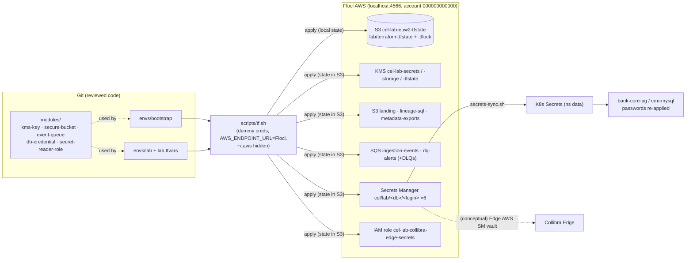
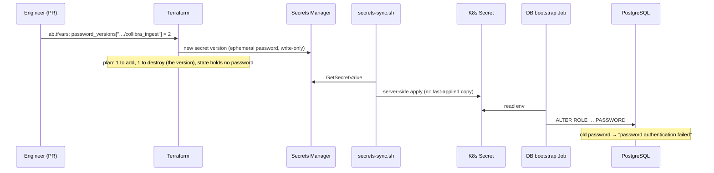

# Phase 5 — Terraform on Floci: Keys, Storage, Queues, Secrets, IAM

**Date:** 2026-11-11 · **Status:** ✅ AWS (emulated) applied and verified · ⏸ Azure Terraform pending a decision (§9)

| Result | Evidence |
|---|---|
| 2 stacks (`bootstrap`, `lab`), 5 reusable modules, **64 resources** on Floci AWS | `terraform apply` logs |
| Remote state in S3 with **S3-native locking**, KMS-encrypted, versioned | `envs/lab/backend.hcl` |
| **No password in Terraform state or plan** (ephemeral + write-only) | `scripts/tf-verify.sh`: 0 of 6 passwords found in state |
| Secrets Manager is the **source of truth** for DB credentials, synced to Kubernetes | `scripts/secrets-sync.sh` → `db-verify.sh` 28/28 |
| Rotation proven: old password rejected, new one works. One-line rotation via `password_version` | §6 |
| No drift (`plan` → no changes). Trivy IaC scan: 0 medium+ findings | `tf-verify.sh` 15/15 |

**Classification:** Terraform, state, locking and the Kubernetes sync are **real**. The AWS services are **emulated** by Floci. The IRSA role's EKS OIDC trust is **illustrative**: there is no EKS cluster.

---

## 1. What, why, and how it fits

**Terraform** is a *declarative* tool: you describe the end state, Terraform works out the API calls to reach it, and it records what it manages in a **state file**.
Analogy: Terraform is an architect's drawing plus a site log. The drawing (`.tf`) says what should exist, the log (state) says what was actually built, and `plan` is the surveyor comparing the two.

**Why here:** a bank must be able to rebuild any environment from code, review every change before it happens (`plan` in a pull request), and prove to auditors what exists and who changed it.

**What Terraform does *not* do in this lab:** install Collibra Edge (that uses Collibra's installer / Edge CLI), or deploy Kubernetes workloads (Helm and Argo CD do that in Phases 6–7). Terraform owns **cloud resources**.



## 2. Repository layout and conventions
```
infrastructure/terraform/
├── modules/                      reusable building blocks (no provider config inside)
│   ├── kms-key/                  CMK + rotation + alias
│   ├── secure-bucket/            S3 + SSE-KMS + versioning + public-access block + TLS-only policy + lifecycle
│   ├── event-queue/              SQS + DLQ + redrive (allow) policy
│   ├── db-credential/            Secrets Manager secret, Edge JSON shape, ephemeral password
│   └── secret-reader-role/       IRSA-style least-privilege role
└── envs/
    ├── bootstrap/                creates the state bucket (local state)
    └── lab/                      everything else (state in S3), lab.tfvars, backend.hcl
```

| Convention | Rule | Example |
|---|---|---|
| Resource names | `<org>-<env>-<region>-<component>` | `cel-lab-euw2-landing` |
| Secrets | `cel/<env>/<system>/<login>` | `cel/lab/bank-core-pg/collibra_ingest` |
| KMS aliases | `alias/<org>-<env>-<purpose>` | `alias/cel-lab-secrets` |
| Mandatory tags | `Project, Environment, Owner, CostCentre, ManagedBy, Stack` via `default_tags` | — |
| Version pins | Root: `aws ~> 6.72`, `random ~> 3.9`. Modules: ranges (`>= 6.0, < 7.0`) | lock file committed |
| Files | `versions.tf, variables.tf, main.tf, outputs.tf` per module | — |

**Dependencies** are implicit through references: `module.secure-bucket` takes `module.kms_storage.key_arn`, so Terraform creates the key first. The only explicit `depends_on` cases are where the API needs ordering that references can't express (lifecycle after versioning, policy after public-access block).

## 3. State strategy
| Stack | Backend | Why |
|---|---|---|
| `bootstrap` | **local** (`terraform.tfstate`, gitignored) | It creates the bucket that would hold it: the chicken-and-egg problem |
| `lab` | **S3** `cel-lab-euw2-tfstate/lab/terraform.tfstate`, `use_lockfile = true` | Shared, versioned (rollback), KMS-encrypted, **locked** so two applies can't corrupt it |

`use_lockfile` (Terraform ≥ 1.10) writes `terraform.tfstate.tflock` with a conditional S3 PUT. It replaces the DynamoDB lock table that older guides, including Floci's own, still use.
**In a bank:** separate state per environment *and* per blast radius (network, data, apps). State-bucket access limited to the CI role. Bootstrap state migrated into the bucket (`terraform init -migrate-state`).

## 4. Secrets that never touch state
**The problem:** Terraform historically stored *every* attribute, including generated passwords, in plain text in state. Whoever can read the state bucket has every database password, and auditors flag this.

**The fix (Terraform 1.10/1.11+):**
```hcl
ephemeral "random_password" "this" { length = 32, special = false }   # exists only during the run

resource "aws_secretsmanager_secret_version" "this" {
  secret_string_wo         = jsonencode({ ..., password = ephemeral.random_password.this.result })
  secret_string_wo_version = var.password_version                      # bump to rotate
}
```
- *Ephemeral* values are never written to state or plan files.
- *Write-only* attributes (`*_wo`) are sent to the API but stored as `null`. The plan shows `(write-only attribute)`.
- **Proven:** `tf-verify.sh` fetches all 6 real passwords and searches the remote state: **0 found**. `secret_string_wo` is `null` in state.

The secret JSON is exactly what a **Collibra Edge AWS Secrets Manager vault** reads (Phase 2 §6.2):
```json
{ "engine":"postgres", "host":"bank-core-pg.data.svc.cluster.local", "port":5432,
  "dbname":"bank_core", "username":"collibra_ingest", "password":"<32 chars>" }
```
`terraform output collibra_edge_vault_references` prints what you would type into the Edge connection: *Secret Name* `cel/lab/bank-core-pg/collibra_ingest`, *Field* `/username` and `/password`.

**Scope decision:** Terraform owns the 6 service/application credentials. The `postgres` and MySQL `root` superusers stay **break-glass** secrets outside the pipeline: rotating them needs the old password, and banks keep them in a PAM vault (CyberArk) with check-out and session recording.

## 5. Least privilege for Collibra Edge (IRSA pattern)
On EKS, Edge would get AWS access without any stored keys: its Kubernetes service account is mapped to an IAM role through the cluster's OIDC provider (IRSA). The role created here:
- `secretsmanager:GetSecretValue` / `DescribeSecret` on **exactly 3 ARNs**, the `collibra_*` secrets (filtered by the `consumer` attribute in `locals.tf`). It can't read the app or migrator credentials.
- `kms:Decrypt` **only** via `secretsmanager.eu-west-2.amazonaws.com` (the `kms:ViaService` condition), so the key can't be used directly.
- Trust only `system:serviceaccount:collibra-edge:edge-vault-reader` with audience `sts.amazonaws.com`.
Floci stores IAM but does **not** evaluate it, so this is verified by inspecting the policy document, not by an access-denied test.

## 6. Rotation: the full loop (proven)

Commands:
```bash
# edit envs/lab/lab.tfvars, then:
scripts/tf.sh lab plan -out=tfplan && scripts/tf.sh lab apply tfplan
scripts/db-load.sh          # syncs from Secrets Manager, re-applies passwords
scripts/db-verify.sh        # 28/28
```
In production, the **External Secrets Operator** replaces `secrets-sync.sh`, and Secrets Manager's own rotation Lambda (or a CyberArk CPM plugin) changes the DB password and the secret together.

## 7. The Terraform lifecycle, demonstrated

| Command | What it does | Seen in this phase |
|---|---|---|
| `init` | Downloads providers (verifies HashiCorp signatures), configures the backend, writes `.terraform.lock.hcl` | aws 6.72.0, random 3.9.1; S3 backend configured |
| `validate` | Syntax and type checks, no API calls | "The configuration is valid" |
| `plan -out=tfplan` | Reads real state, diffs, saves an **exact** change set | 9 / 57 to add |
| `apply tfplan` | Applies *only* the reviewed plan | 9 + 57 created |
| `plan -detailed-exitcode` | Exit 0 = no drift, 2 = changes pending | 0 for both stacks |
| `destroy` | **Not run.** Needs your explicit approval | — |

```bash
scripts/tf.sh bootstrap init && scripts/tf.sh bootstrap plan -out=tfplan && scripts/tf.sh bootstrap apply tfplan
scripts/tf.sh lab init && scripts/tf.sh lab validate && scripts/tf.sh lab plan -out=tfplan && scripts/tf.sh lab apply tfplan
scripts/tf.sh lab output collibra_edge_vault_references
scripts/tf-verify.sh        # 15 checks
trivy config infrastructure/terraform
```

## 8. Troubleshooting (all encountered for real)

| # | Symptom | Root cause | Fix | Lesson |
|---|---|---|---|---|
| 1 | `Error: Too many command line arguments` on `apply tfplan` | Wrapper appended `-var-file` after the positional plan file, and a saved plan forbids `-var-file` anyway | Insert flags after the subcommand. Skip `-var-file` for saved plans | Saved plans are self-contained |
| 2 | `S3 Control: ListTagsForResource … 403 AccessDenied` (real AWS HostID) | AWS provider 6 reads bucket tags through **S3 Control**, and no `s3control` endpoint was set, so the call went to **real AWS** (with dummy keys, so it was refused harmlessly) | `AWS_ENDPOINT_URL` global override in the wrapper + explicit `s3control` | Per-service endpoint lists are fragile. Add a global fallback |
| 3 | `lookup 000000000000.127.0.0.1: no such host` | S3 Control puts the account ID in the hostname. An IP can't take a subdomain | Endpoint `http://localhost:4566`: `*.localhost` resolves to loopback (RFC 6761) | Use hostnames for emulators |
| 4 | Plan after a failed apply: "1 to destroy" | A resource whose create fails midway is **tainted** and replaced next time | Normal. Check that it's safe (empty bucket) | Read every `-/+` before approving |
| 5 | Lifecycle configuration took 56 s | Provider polls until it reads back what it wrote. Floci's response differs slightly | None needed. Drift check is clean | Emulator fidelity gap |
| 6 | Verify "0 leaks" while checking **0** secrets | zsh doesn't word-split `$AWS`, so the loop never ran | Move checks into a bash script. Assert the number of items checked | Guard against vacuous passes |
| 7 | `KeyCount: null` from `ListObjectsV2` | Floci omits a field real S3 returns | Count `Contents` instead | Never assume emulator = cloud |
| 8 | `crm_app` would have kept its old password after rotation | MySQL image sets `MYSQL_PASSWORD` only on first boot | Load Job runs `ALTER USER crm_app … IDENTIFIED BY` | Rotation must be applied by something that runs every time |

Other common failures: `Error acquiring the state lock` (another apply is running, or a crashed run left `.tflock`. Confirm, then `terraform force-unlock <ID>`). `AccessDenied` on `allowed_account_ids` (wrong credentials for this environment, which is the guard working). `Provider produced inconsistent result` (provider/emulator mismatch: upgrade the provider or report it).

## 9. Azure: status and options
Floci's Azure emulator works with the `azurerm` provider, but **only over HTTPS**:
1. `FLOCI_AZ_TLS_ENABLED=true` on `floci-az`: a change to your `~/floci/docker-compose.yml` + container restart (its in-memory Azure state is reset).
2. Terraform must trust Floci's self-signed certificate: normally added to the **macOS trust store**.
3. Key Vault: `https://<name>.vault.azure.net` must resolve to Floci on port 443: normally an **`/etc/hosts`** edit.

Items 2–3 change system security settings, so I haven't done them. **Contained alternative (recommended):** run Azure Terraform in a throwaway Linux container on Floci's Docker network. The cert is trusted via `SSL_CERT_FILE` *inside* the container, and the vault hostname is a Docker network alias. Only item 1 changes your Floci setup, and nothing on macOS changes. Until then, the Azure side stays covered by the Phase 3 smoke test (Blob, Queue, Key Vault via the CLI and REST).

## 10. How production differs
- Real AWS accounts per environment (AWS Organizations), the CI role assumed through OIDC from GitHub Actions (no stored keys), `allowed_account_ids` per environment.
- Policy-as-code gates in CI (Trivy/Checkov/OPA/Sentinel) and mandatory plan review in pull requests. `apply` runs only from the pipeline.
- KMS key policies scoped to roles (not the account root), SCPs, CloudTrail data events on secrets and the state bucket.
- Bucket policies and IAM are **enforced** (Floci stores but doesn't evaluate them).

## 11. Interview preparation
**Q1. How do you stop Terraform from leaking database passwords?**
Since Terraform 1.10/1.11: generate them with an *ephemeral* resource and pass them only to *write-only* arguments (e.g. `secret_string_wo`), so they never enter state or plan. Before that: let Secrets Manager generate and rotate the password (`manage_master_user_password` on RDS) and keep Terraform out of the value. In both cases, encrypt and lock down the state bucket anyway, because state still holds sensitive metadata.

**Q2. Remote state: what problems does it solve and how do you lock it?**
Sharing (team and CI see one truth), durability and versioned rollback, encryption, and **locking** so concurrent applies can't corrupt state. On S3, `use_lockfile = true` (conditional writes) since 1.10. Previously a DynamoDB table. Bootstrap the bucket in a separate stack.

**Q3. A plan shows a resource will be replaced (`-/+`) that you expected to update in place. What do you do?**
Stop and read *which* attribute `# forces replacement`. Decide whether replacement is acceptable (a secret version: yes; a database or a bucket with data: no). Options: change the approach, use `lifecycle { prevent_destroy = true }` on critical resources, `create_before_destroy`, or `moved`/`import` blocks for refactors. Never apply an unexplained replacement in production.

## 12. Knowledge checkpoint
1. After rotating `collibra_ingest` with `password_version = 2`, which three things had to happen, in which order, before the database accepted the new password?
2. Why does the Edge IAM policy use `kms:ViaService` instead of simply allowing `kms:Decrypt` on the key?
