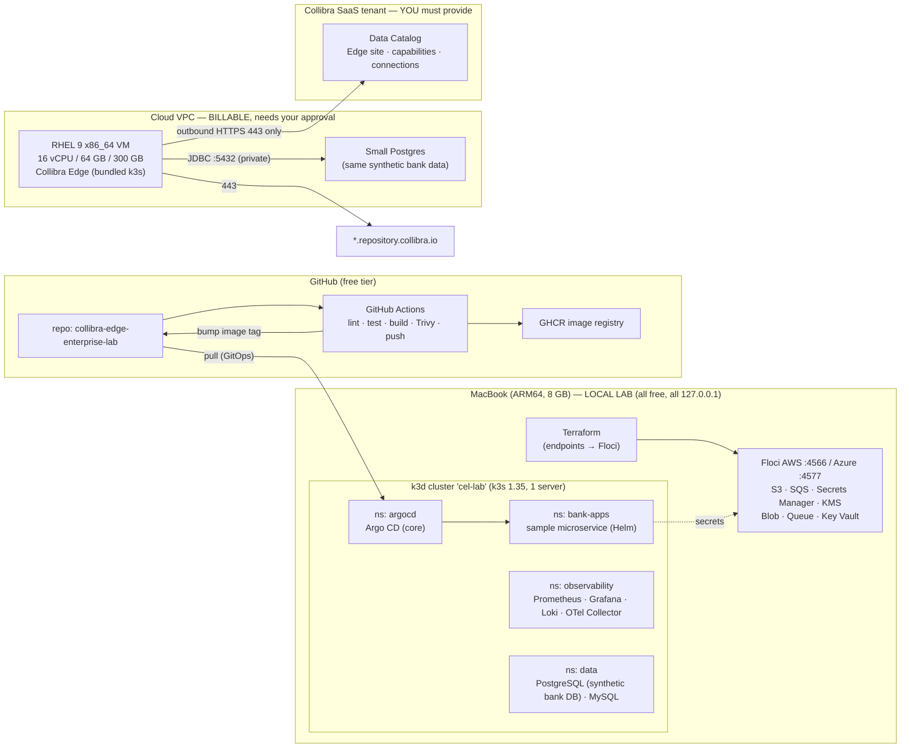
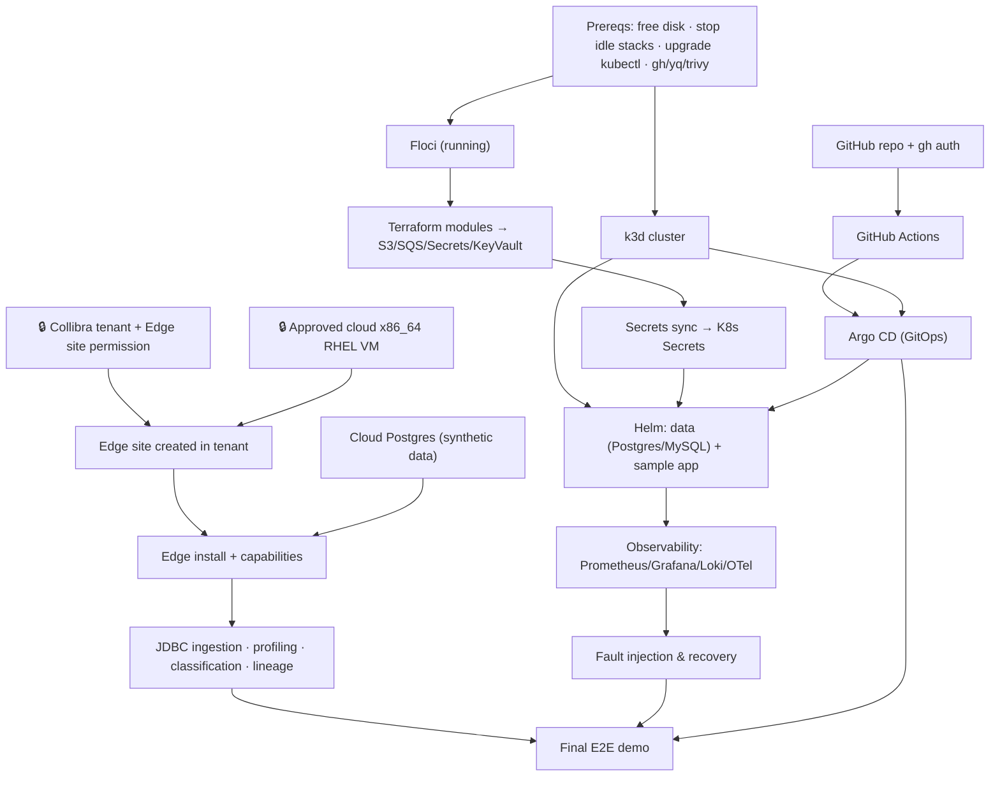

# Phase 1 — Environment Assessment & Target Architecture

**Project:** Collibra Edge Enterprise Lab
**Date:** 2026-11-11
**Status:** Assessment complete. Nothing has been installed or changed. Waiting for approval before Phase 2.

> **The main finding first.** Collibra Edge **cannot run on this laptop** in any configuration Collibra supports, or even in an unsupported one that would actually work. The official requirements are **x86_64, 16 cores, 64 GB RAM and ~255 GB disk on RHEL 8.8+/9.3+**. This machine is **ARM64, 8 cores, 8 GB RAM, with 19 GB of free disk**. Everything else in the project can run locally. Edge itself has to run either on a rented x86_64 Linux VM (which costs money and needs your approval) or be documented conceptually only. Either way you also need a real **Collibra tenant**. Details are in §6.

---

## 1. Environment assessment

### 1.1 Hardware and OS

| Item | Found | Assessment |
|---|---|---|
| Machine | MacBook Air, **Apple M2** | Fanless, so it throttles under sustained load |
| OS | macOS 26.2 (Darwin 25.2.0) | OK for tooling |
| CPU architecture | **arm64** | ❌ Collibra Edge requires **x86_64** |
| CPU cores | 8 (4 performance + 4 efficiency) | ❌ Edge needs 16 |
| RAM | **8 GB** | ❌ Edge needs 64 GB. **Already under pressure:** 4.0 of 5.1 GB swap in use |
| Disk free | **19 GB** (data volume 96% full) | ❌ Edge needs ~255 GB. 🔴 **Critical even for the local lab** |

### 1.2 Container and Kubernetes tooling

| Tool | Version | Assessment |
|---|---|---|
| Docker Desktop | 25.0.3, Linux VM **arm64**, **4 GB RAM / 8 CPU** allocated | OK. amd64 emulation works (Rosetta/QEMU), but it is slow |
| Docker Compose | v2.24.5 | OK |
| kubectl | **v1.29.2** | ⚠️ Too old for k3s 1.35 (kubectl supports ±1 minor version). Upgrade it |
| Helm | v3.13.3 | ✅ OK (upgrade optional) |
| k3d | v5.9.0 (default k3s **v1.35.5**) | ✅ Best fit for the local cluster. Same k3s line Edge bundles |
| kind / minikube / colima / lima / multipass | not installed | Not needed |
| Terraform | **v1.5.7** | ⚠️ Works, but it is old. Recommend 1.9+ (or OpenTofu) |
| Git | 2.42.1 (user configured, 2 SSH keys) | ✅ |
| gh (GitHub CLI) | **missing** | Needed for Phase 8 |
| argocd CLI, trivy, yq, tflint, psql, sqlcmd | **missing** | Install them in the phases that need them |
| jq, mysql client | present | ✅ |
| Python | 3.12.3 (pyenv) | ✅ Synthetic data generation |
| Java | OpenJDK 21 (default), OpenJDK 11 | ✅ Not needed by Edge on our side |
| AWS CLI / Azure CLI | 2.27.25 / 2.73.0 | ✅ Can point at Floci endpoints |

### 1.3 Existing Kubernetes contexts — **I will not touch these without your approval**

| Context | State | Note |
|---|---|---|
| `docker-desktop` (**current context**) | 🔴 API on :6443 returns EOF (unhealthy) | It holds port 6443 and uses RAM for nothing. Recommend disabling it in Docker Desktop settings |
| `k3d-other-project-a` | stopped (Exited 137) | Belongs to another project. Leave it alone |
| `<real-aks-context>` | **real Azure AKS** | ⚠️ **Billable production-like target.** All lab commands will pass an explicit `--context` |

### 1.4 Existing containers (≈1.7 GB RAM in use before the lab starts)

- **Floci, already running** (started 2 days ago, host bind `~/floci/data`):
  - `floci` 2.4.0 (AWS) on `127.0.0.1:4566`. **129 services report running**, including s3, sqs, secretsmanager, kms, rds, iam, eks, logs and monitoring.
  - `floci-az` 0.16.0 (Azure) on `127.0.0.1:4577`. blob, queue, table, functions, keyvault, cosmos, appconfig, servicebus, eventhub, postgres/mysql/mariadb (Docker-backed), **aks (backed by k3s)**, sql (*control plane only, no data plane*).
  - `floci-gcp` 0.12.0 on `127.0.0.1:4588`, plus `floci-ui` 0.7.0 on `127.0.0.1:4500`.
- **`other-project-a-*` stack** (13 containers, including Postgres :5433, Redis :6380, Grafana :3002, Prometheus :9090).
- **`other-project-b_*` stack**: Postgres **0.0.0.0:5432**, Redis 0.0.0.0:6379, :3000, :8000 (⚠️ bound on all interfaces).
- Exited: `mysql8`, `adminer`, `k3d-other-project-a-*`.
- 20 volumes. Docker can reclaim **~6.3 GB** (3.7 GB dangling images + 2.6 GB build cache). That needs your approval.

### 1.5 Ports in use → ports reserved for the lab

| In use | Lab will use instead |
|---|---|
| 5432 (other-project-b_db), 5433 (other-project-a) | **15432** PostgreSQL (lab) |
| 3306 (native mysqld) | **13306** MySQL |
| 3000, 3001, 3002 | **13000** Grafana |
| 8080 (java), 8081 | **18080** Argo CD UI |
| 9090 | **19090** Prometheus |
| 6443 (docker-desktop) | **16443** k3d API server |
| 4566/4577/4588/4500 | Reuse the existing Floci |

The lab binds everything to `127.0.0.1` only.

---

## 2. Collibra Edge — official requirements (verified 2026-11-11)

Sources: Collibra Product Resource Center: [System requirements](https://productresources.collibra.com/docs/collibra/latest/Content/Edge/EdgeSitesInstallation/ref_edge-site-system-requirements.htm) (updated 29 Oct 2026), [Edge compatibility](https://productresources.collibra.com/docs/collibra/latest/Content/ReleaseNotes/ref_compatibility-edge.htm) (14 Oct 2026), [Edge FAQ](https://productresources.collibra.com/docs/collibra/latest/Content/Edge/ref_edge-faq.htm) (5 Nov 2026).

| Requirement | Bundled k3s install | Managed Kubernetes |
|---|---|---|
| CPU / RAM | **16-core x86_64, 64 GB** | Cluster total ≥16 cores / 64 GB (e.g. 4 × 4c/16 GB, or 2 × 8c/32 GB) |
| Disk | ≥50 GB `/var/lib/rancher/k3s` (no `noexec`), ≥5 GB `/var/log`, **≥200 GB `/var/lib/kubelet`** (+15 GB per concurrent lineage run) | ≥100 GB per worker node |
| OS | **RHEL 8.8+ or 9.3+ only.** RHEL 8 needs cgroup v2 with k8s ≥1.35 | Linux nodes. Install host: x86_64 Linux with bash |
| Platforms | k3s version bundled by the installer (1.35 as of Edge 2026.05.35) | EKS, AKS, GKE, EKS Fargate 1.33–1.36. OpenShift 4.15–4.21 |
| Nodes | One **dedicated** VM per Edge site | ≥1 worker, ≥2 recommended |
| Install method | Edge site installer from the tenant | **Edge CLI (recommended)** or Helm chart (Helm 3, yq ≥4.18.1, jq). Collibra won't support custom Helm/K8s configs |
| Network | **Outbound only, 443**: tenant URL + `*.repository.collibra.io`. `ip_forward=1`. ≤3 search domains / 2 nameservers. 10.42/10.43 CIDRs open | Same, plus IRSA on EKS |
| Other | No HA. k3s internal certs expire after 12 months. Edge uses its own `ca.pem`, not the host truststore | — |

**Not supported:** ARM64, Apple Silicon, Docker Desktop, kind, minikube and generic self-installed k3s are **not mentioned anywhere** in the docs. The only architecture named is x86_64 and the only OS named is RHEL. Treat all of them as **unsupported**. Windows is explicitly unsupported.

**Uncertainties I'm flagging:**
- The compatibility table lists all managed versions together, not per platform.
- I have not yet read the install procedure itself (`ta_install-edge-site.htm`), the forward-proxy page, or the capability pages. That is Phase 2.
- Exact JDBC, profiling, classification and lineage capability behaviour depends on your tenant's licence.

---

## 3. Floci — verified locally, not from marketing

| Cloud | Services relevant to this lab (live on your machine) | Caveat |
|---|---|---|
| AWS (`:4566`) | S3, SQS, SNS, Secrets Manager, KMS, IAM, RDS/rds-data, Logs, CloudWatch metrics, EKS (API) | Floci's RDS/EKS are **API emulations**. Whether they start real engines/clusters is verified in Phase 3. **Edge cannot be installed on them.** |
| Azure (`:4577`) | Blob, Queue, Table, Key Vault, Functions (Docker), Postgres/MySQL (Docker-backed), Service Bus, AKS (k3s-backed) | `sql` (SQL Server) has **no data plane**. AKS-on-k3s is **not** a Collibra-supported AKS |
| GCP (`:4588`) | Available | Low priority |
| OCI | Not running | Optional |

**Architectural rule:** Floci emulates cloud *APIs* so Terraform and SDK code can run for free. It does **not** make a laptop into EKS/AKS/GKE, and Collibra Edge will not run on it.

---

## 4. Target architecture (recommended: **Option A — hybrid**)

**Why Edge can't scan the laptop's Postgres directly:** Edge only makes *outbound* connections and must reach the data source over the network. A cloud VM cannot reach `127.0.0.1` on your Mac. So the metadata-ingestion data source gets a copy inside the same cloud VPC. The *same* schema and seed scripts feed both databases, which keeps everything reproducible.

### Alternatives

| Option | What you get | Cost | Verdict |
|---|---|---|---|
| **A. Hybrid** (above) | Real Edge + real ingestion + full local platform | Roughly **$1–1.5/hr** while the Edge VM runs (16 vCPU/64 GB RHEL on-demand + 300 GB disk). Stop it when idle. *I'll quote exact prices before anything is created.* | ✅ Recommended **if you have a Collibra tenant** |
| **B. Local only** | Everything except Edge. Edge install, ingestion and capabilities are documented and diagrammed, clearly labelled *conceptual* | $0 | ✅ Fallback if there's no tenant or no cloud budget |
| C. Edge on the laptop (x86 emulation in a VM) | Nothing usable: 8 GB host vs 64 GB required, ARM to x86 emulation, 19 GB disk | — | ❌ Rejected |
| D. Edge on Floci "EKS/AKS" | Not a supported platform, and not enough resources | — | ❌ Rejected |

---

## 5. Technology stack (local, sized for 8 GB)

| Layer | Choice | Why (lightweight) | Est. RAM |
|---|---|---|---|
| Cluster | **k3d** (1 server, Traefik off, local-path storage) | Already installed. Same k3s as Edge | ~600 MB |
| Databases | PostgreSQL 16, MySQL 8 | SQL Server images are amd64-only and need ≥2 GB, so it is **deferred/conceptual** | ~250 + ~400 MB |
| Cloud emulation | Existing Floci (AWS + Azure) | Already running | ~350 MB |
| IaC | Terraform (Floci endpoints, local state backend) | — | CLI only |
| Packaging | Helm 3, own chart for a sample "payments-api" | — | ~100 MB |
| GitOps | Argo CD **core** install (no Dex/notifications) | Smaller than the full install | ~400 MB |
| Monitoring | Prometheus (short retention) + Grafana | *Not* full kube-prometheus-stack | ~500 MB |
| Logging | Loki single-binary + Promtail/Alloy | Lighter than ELK by ~2 GB | ~250 MB |
| Telemetry | OpenTelemetry Collector | — | ~100 MB |
| CI | GitHub Actions (hosted) + Trivy + GHCR | Runs in GitHub, not on your Mac | 0 |
| Secrets | Floci Secrets Manager / Key Vault + External Secrets Operator (evaluate) or a sync script | — | ~100 MB |
| **Total if all running** | | | **≈3.0–3.5 GB of Docker's 4 GB** |

**Consequence:** the laptop can run the full lab **only if the `other-project-a` and `other-project-b` stacks are stopped during lab sessions** (≈1.7 GB) and Docker Desktop's Kubernetes is disabled. Stopping them is non-destructive (`docker compose stop`, volumes kept), but I'll only do it with your approval. Heavy components (monitoring, Argo CD) will also be brought up **phase by phase**, not all at once.

---

## 6. Component dependency map

🔒 = blocked until you provide it.

---

## 7. Installation roadmap

| # | Phase | Runs where | Blocked on | Complexity |
|---|---|---|---|---|
| 1 | Assessment (this doc) | — | — | ✅ done |
| 2 | Collibra Edge deep research (install procedure, capabilities, proxy, upgrades, backup, troubleshooting) | docs | — | Low |
| 3 | Local prerequisites: disk cleanup, stop idle stacks, tool upgrades, repo + git init, k3d cluster, Floci service validation | laptop | **your approvals** | Low–Med |
| 4 | Synthetic bank data (customers, accounts, payments, transactions, PII) + Postgres/MySQL via Helm | laptop | — | Medium |
| 5 | Terraform modules against Floci (S3, SQS, Secrets Manager, KMS, Blob, Queue, Key Vault) | laptop | — | Medium |
| 6 | Helm from first principles + sample `payments-api` chart (all K8s objects, probes, HPA) | laptop | — | Medium |
| 7 | GitHub Actions CI + GHCR + Argo CD GitOps | GitHub + laptop | GitHub repo, `gh auth` | Medium–High |
| 8 | Security: RBAC, NetworkPolicies, secrets, TLS, Trivy, audit | laptop | — | Medium |
| 9 | Observability: Prometheus, Grafana dashboards, Loki, OTel | laptop | RAM headroom | Medium |
| 10 | **Collibra Edge** on a cloud VM: create site in tenant → install → verify → capabilities → JDBC ingestion | cloud | 🔒 **tenant + cloud approval** | **High** |
| 11 | Fault injection (10 scenarios, never against Edge) | laptop | — | Medium |
| 12 | E2E demo script + final diagrams + interview pack | all | — | Medium |

**Rough effort:** ~6–9 working sessions for the local lab and 1–2 sessions for Edge, once access exists.

---

## 8. Prerequisite checklist

### You must provide or decide
- [ ] **Collibra tenant URL** with a role that can create Edge sites and connections (e.g. a Sysadmin, or an Edge site admin global role). *I will never fabricate one.*
- [ ] Confirm your licence includes **Edge + Data Catalog** (and optionally profiling/classification and technical lineage).
- [ ] **Option A or B?** If A: which cloud (AWS / Azure), which account, and a budget ceiling. **Nothing billable gets created without your explicit OK on a specific price.**
- [ ] A GitHub account/repo for Actions and Argo CD (public repo = simplest Argo CD pull; private needs a deploy key).

### Local actions that need your approval (non-destructive except where marked)
- [ ] Free disk space: `docker builder prune` (2.6 GB) + remove dangling images (3.7 GB). ⚠️ *Deletes caches, but no volumes or data.*
- [ ] Stop the `other-project-a` and `other-project-b` stacks during lab sessions (`docker compose stop`, data volumes preserved).
- [ ] Disable Docker Desktop's built-in Kubernetes (currently unhealthy).
- [ ] `brew install`/`upgrade`: kubectl (≥1.34), terraform (≥1.9), gh, yq, trivy, argocd, psql (libpq), tflint.
- [ ] `git init` the project repo in this folder.

### Already satisfied
- [x] Docker Desktop, Compose, Helm 3, k3d (k3s 1.35), Git, Python 3.12, jq, AWS & Azure CLIs
- [x] Floci AWS/Azure/GCP running on localhost

---

## 9. Risks and limitations

| Risk | Impact | Mitigation |
|---|---|---|
| 19 GB free disk (96% full) | Image pulls fail mid-phase. Corrupt Docker VM | Clean up before Phase 3. Keep ≥10 GB free. Monitor `docker system df` |
| 8 GB RAM, swap already 4 GB | OOM / sluggish macOS | Stop idle stacks. Stage components. Strict resource limits |
| `~/.aws` has **real** credentials, and a **real AKS** context exists | Accidental billable/real changes | Dedicated `floci` AWS profile with dummy keys. Terraform `endpoints` + `skip_*` flags. Explicit `--context k3d-cel-lab` on every command |
| `other-project-b_db`/Redis exposed on `0.0.0.0` | LAN exposure (existing, not ours) | Flagged only. The lab binds to 127.0.0.1 |
| Edge unsupported locally | No real ingestion without the cloud | Option A or clearly labelled Option B |
| Floci fidelity gaps (RDS/EKS/SQL data plane) | An integration may only be API-level | Validate each service before relying on it (Phase 3). Label it *emulated* |
| SQL Server amd64-only | Slow or unstable under emulation | Deferred. Optional Azure SQL Edge/emulated test later |
| Tenant licence limits | Profiling/classification/lineage untestable | Document the exact limitation (rule 20) |
| Terraform 1.5.7 / kubectl 1.29 | Provider or API incompatibilities | Upgrade in Phase 3 |

---

## 10. What is real vs emulated vs conceptual (initial classification)

| Component | Status |
|---|---|
| Kubernetes (k3d/k3s), Helm, Argo CD, Prometheus/Grafana/Loki/OTel, Postgres/MySQL, GitHub Actions | **Real** (local) |
| AWS/Azure services (S3, SQS, Secrets Manager, Key Vault…) | **Emulated** (Floci) |
| Collibra Edge + ingestion | **Real only with Option A + tenant.** Otherwise **conceptual** |
| SQL Server | **Conceptual/deferred** |
| EKS/AKS for Edge | **Conceptual** (documented, not deployed) |

---

## 11. Interview preparation

**Q1. Why can't you run Collibra Edge on a developer's MacBook?**
Edge is supported only on x86_64 RHEL 8.8+/9.3+ with its bundled k3s, or on managed EKS/AKS/GKE/OpenShift. It needs 16 cores and 64 GB RAM, with ~200 GB on `/var/lib/kubelet` because ingestion, profiling and lineage jobs run as pods. Apple Silicon is ARM64, and Docker Desktop, kind and minikube aren't supported targets. A senior engineer separates "it might boot" from "it's supportable": in a bank, an unsupported Edge means no vendor support during an incident.

**Q2. How does Edge connect to Collibra Cloud through a bank firewall?**
Outbound HTTPS 443 only, to the tenant URL and Collibra's image repository. There is no inbound connection. Data stays inside the bank's network: Edge processes it locally and sends *metadata* (and only sample/profile results if enabled) to the SaaS tenant. If there's a TLS-inspecting proxy, its CA must be added to Edge's own `ca.pem`, because Edge ignores the host truststore.

**Q3. What does Floci give you, and what doesn't it?**
It emulates cloud *APIs* (S3, SQS, Secrets Manager, Key Vault…) so IaC and application code can be tested offline at no cost. It is not a managed Kubernetes provider and has fidelity gaps. It suits dev/test and CI, not vendor-support validation.

## 12. Knowledge checkpoint (please answer before Phase 2)
1. Edge only makes outbound connections. In Option A, why can't the cloud Edge VM ingest from the PostgreSQL running on your Mac, and what are two ways to solve it?
2. Which of these is a supported Edge platform: k3d on macOS, AKS 1.35, or Floci's AKS emulator? Why?
