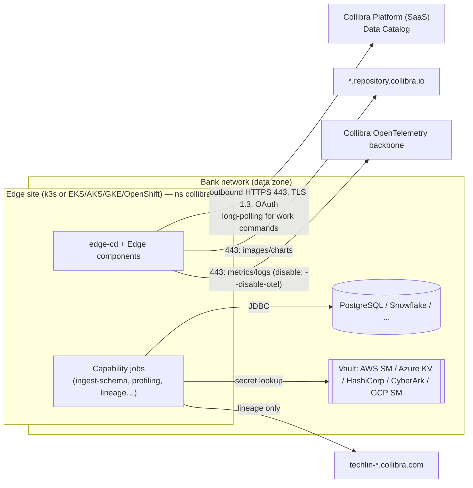
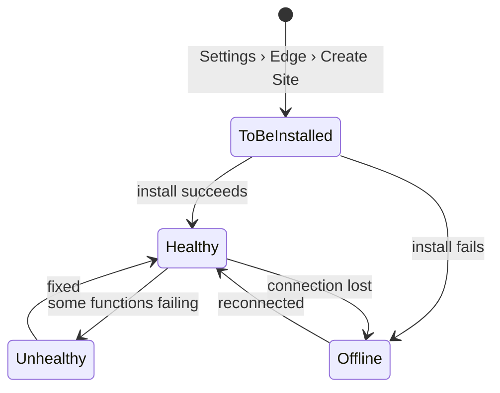
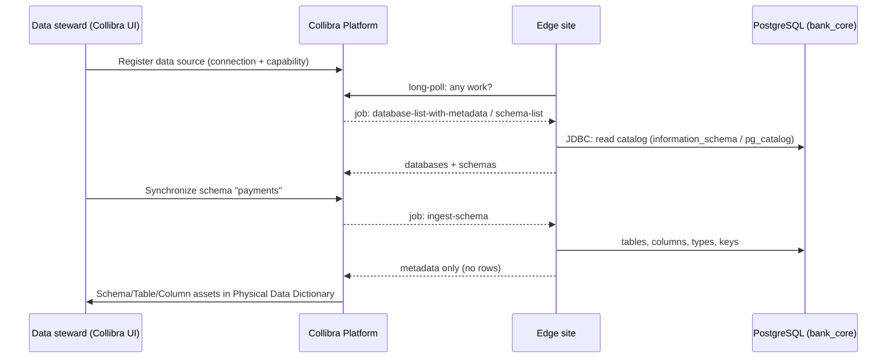

# Phase 2 — Collibra Edge: Official Documentation Research

**Date:** 2026-11-11 · **Lab mode:** Option B (local only). In this lab, every Edge step below is **CONCEPTUAL**: documented from official sources, not executed.
**Sources:** Collibra Product Resource Center, `docs/collibra/latest`, pages dated Jan–Nov 2026 (URLs in §12).

Confidence labels used throughout:
- ✅ **Verified**: verbatim on an official page.
- 🟡 **Partial**: the page was truncated or summarised, or two pages disagree.
- ❓ **Unverified**: not found. Must be confirmed with Collibra before relying on it.

---

## 1. What Edge is, and why it exists

**Analogy.** Collibra Platform is a library catalogue in the cloud. Your bank's databases are the books, and they are locked in your own building. Edge is a librarian *employed inside your building*: it reads the books, writes catalogue cards (metadata), and only posts the cards out. The books never leave.

- ✅ "An Edge site is a compute run-time on the Kubernetes cluster."
- ✅ Edge connects to data sources "hosted in an on-premises or cloud environment", processes them locally and "send[s] the results to Collibra".
- ✅ Site types: **Standard** (you install it) and **Collibra Cloud** (Collibra hosts it; several capabilities are "limited", there is no Edge CLI, and no vaults).

**Why a bank wants this:** data-residency and regulatory rules (e.g. keeping customer PII in-country) and a security policy of **no inbound connections from SaaS into the data zone**. Credentials never leave the bank's perimeter.



---

## 2. Communication, authentication and trust ✅

| Topic | Official fact |
|---|---|
| Direction | **Outbound only.** "No inbound connectivity – Edge site is always polling the platform." The site retrieves tasks as work commands through **long polling** |
| Transport | HTTPS 443, **TLS 1.3**, "either basic authentication or OAuth" |
| Identity | Downloading the installer creates a **dedicated service account** in Collibra. Sites installed with 2025.08+ use **OAuth client credentials**; older sites use username/password |
| Credential rotation | Only by **re-downloading the installer and reinstalling**. New Client ID/Secret land in `resources/manifests/edge-secret.yaml` |
| Tenancy | "Every Edge site belongs and authenticates to only one Collibra Platform environment" |
| mTLS / customer client certificates | **Not supported** |
| Private connectivity (PrivateLink etc.) | "Not available by default" |
| Secrets at rest | Encrypted with a **key pair split between Edge and Collibra**. Credentials are "not accessible outside of Edge" |
| Truststore | "Edge does not use the host TLS truststore." By default Edge trusts only public CAs. A private or MITM CA goes in `ca.pem` (max **100 KB**) |

**Enterprise implication:** the firewall team only needs **egress** rules: tenant URL, `*.repository.collibra.io` (or the three explicit hosts), `techlin-*.collibra.com` for lineage, and every data source. Nothing needs to be opened inbound.

---

## 3. Roles and permissions (global) ✅ / 🟡

| Permission | Allows | Example default role |
|---|---|---|
| **Manage Edge sites** | Create, edit and delete Edge sites | Edge site administrator |
| **Install Edge sites** (+ "User Administration" 🟡) | Download the installer/properties and install | Edge site administrator |
| **Connect as Edge site to Collibra** | Held by the Edge **service account** itself | Edge site |
| **Manage connections and capabilities** | Create JDBC connections and capabilities, register and profile | Edge integration engineer |
| View Edge connections and capabilities / View logs from Edge site | Read-only operations | Edge manager / viewer roles |
| Product Rights > **System administration** | Required to create JDBC connections and vaults | — |

🟡 The install page names "User Administration", but that permission wasn't found on the global-permissions page. Confirm in your tenant.

**Least-privilege design for a bank:** separate *platform* people (Manage/Install Edge sites) from *data integration* people (Manage connections and capabilities). Give auditors view-only access.

---

## 4. Site lifecycle and status ✅



| Status | Meaning (official) |
|---|---|
| **To be installed** | Created, not installed. Only in this state is "Installer and property files" shown |
| **Offline** | "Collibra cannot reach the Edge site" (failed install or lost connection) |
| **Unhealthy** | "Collibra can connect to the Edge site, but some functions don't work correctly" |
| **Healthy** | "The Edge site installation was successful" |

**Create a site:** Products › Settings › **Edge** › **Create Site** (Name with no spaces or special characters, Description, Upgrade mode). Prerequisite: *Database registration via Edge* enabled in Collibra Console (then restart the DGC service).

---

## 5. Installation methods

| Method | Platform | Tooling | Officially recommended for |
|---|---|---|---|
| **Bundled k3s installer** | Dedicated RHEL 8.8+/9.3+ x86_64 VM (16c/64 GB) | `install-master.sh` | "Easiest option for local installations on a Linux VM running Red Hat" |
| **Edge CLI** | EKS, EKS Fargate, AKS, GKE 1.33–1.36. OpenShift 4.15–4.21 | `edgecli install` | ✅ **Recommended** for managed Kubernetes |
| Helm chart | Same managed platforms | Helm 3, yq ≥ 4.18.1, jq | Manual. "Collibra Support … cannot assist with custom helm and Kubernetes configurations" |
| Zarf | Air-gapped | `zarf` | Air-gapped only |

### 5.1 Common first step (all methods) ✅
1. Settings › Edge › *site name* › **Download Installer**. ⚠️ Every new download **invalidates** the previous installer, which is single-use.
2. `tar -xf <edge-site-id>-installer.tgz`. The archive contains `proxy.properties` and `registries.yaml`. Don't extract onto a `noexec` mount.

### 5.2 Bundled k3s (CONCEPTUAL in this lab) ✅
```bash
# On the RHEL VM, inside the extracted installer directory
sudo sh install-master.sh -r registries.yaml            # basic install
sudo sh install-master.sh -r registries.yaml --proxy --ca  # explicit MITM proxy: uses proxy.properties + ca.pem
# Verify
sudo /usr/local/bin/kubectl get nodes
sudo /usr/local/bin/kubectl get pods --all-namespaces
```
Other flags: `--registry-url/--registry-user/--registry-pass`, `--helm-url/--helm-user/--helm-pass`, `--user-id`, `--group-id`.
Host paths used: `/var/lib/rancher/`, `/var/log/`, `/etc/`, `/usr/local/bin/`.
Host prerequisites: `net.ipv4.ip_forward=1`; `resolv.conf` with ≤3 search domains and ≤2 nameservers; 10.42.0.0/16 and 10.43.0.0/16 not blocked; under firewalld, `cni0` and `lo` in the trusted zone; RHEL 8 needs cgroup v2 with k8s ≥1.35; on cloud VMs disable `nm-cloud-setup.service/.timer`.
**Note:** "You can't use the Edge CLI to install Edge sites on bundled k3s." After install, you copy `edgecli` out of the `edge-cd` pod for day-2 operations.

### 5.3 Managed Kubernetes with the Edge CLI (CONCEPTUAL) ✅
```bash
export EDGE_INSTALLER_PATH=/path/to/installer/installer-<id>
echo $KUBECONFIG                                  # confirm the right cluster!
kubectl apply -f collibra-edge-ns.yaml            # ns labelled pod-security.kubernetes.io/enforce: baseline
./edgecli install -n collibra-edge 2>&1 | tee "edge-installer-$(date +%Y-%m-%d_%H-%M-%S).log"
kubectl get pods -n collibra-edge
```
- **Default mode** needs cluster-admin (it creates namespaces and PriorityClasses).
- **Restrictive mode** needs only a role scoped to the `collibra-edge` namespace. You pre-create cluster objects yourself, e.g. `kubectl apply -f resources/custom/priorityclass.yaml`. Banks usually prefer this because the platform team owns cluster-scoped objects.
- EKS needs IRSA. OpenShift needs the supplied SCC files.
- ⚠️ "Edge CLI is only available on Linux for x86_64 architecture." It won't run on your Mac.

### 5.4 Helm (CONCEPTUAL) 🟡
`helm install collibra-edge collibra-edge-helm-chart/collibra-edge -n <ns> --values site-values.yaml`. Seen only in a page summary, so verify against the real installer. **Our lab will not template or modify Edge's chart** (your rule, and Collibra's support boundary).

### 5.5 What runs inside `collibra-edge` ❓
Only one label is verified: `app.kubernetes.io/name=edge-cd`. **No official page lists all Edge pods**, so we won't invent pod names. Capabilities run as **jobs** (e.g. `ingest-schema`).

---

## 6. Connections, capabilities and metadata ingestion

**Model:** *Site* → *Connection* (how to reach the source + credentials) → *Capability* (what to do with it, run as jobs) → results to Collibra as assets.

### 6.1 JDBC connections ✅
- Types: **Generic JDBC connection (recommended)** and Username/Password JDBC connection.
- Driver: you upload a **driver JAR** and enter the **driver class name**. Collibra publishes **certified drivers on Collibra Marketplace** and recommends using only Edge-certified drivers. Sites can enforce **signed drivers**: `edgecli config signing-key set`. ⚠️ Turning that on immediately breaks connections that use unsigned drivers.
- Permissions: *System administration* + *Manage connections and capabilities*.

### 6.2 Vault integration ✅ (very relevant to this lab)
Supported: **AWS Secrets Manager, Azure Key Vault, Google Secret Manager, HashiCorp Vault 1.19.x** (KV v2 and Database engines), **CyberArk CCP 8.0.0**. Not available on Collibra Cloud sites.
Each connection field is set to Value Type **"Vault Key"**:

| Vault | What you enter |
|---|---|
| AWS Secrets Manager | `Secret Name` + optional `Field` (RFC 6901 JSON pointer, e.g. `/password`) |
| Azure Key Vault | `Vault Name` + `Secret Name` |
| HashiCorp | engine type, engine path, secret path, field/role |
| CyberArk | `Safe=…;Folder=…;Object=…` |
| Google Secret Manager | secret name |

➡️ **Lab tie-in (real, emulated):** in Phase 5 we'll store the bank DB credentials in **Floci Secrets Manager** as JSON (`{"username":…,"password":…}`) and in **Floci Key Vault**, in exactly the shape Edge would read. The applications read them for real. The Edge connection that would reference them stays conceptual.

### 6.3 Capabilities (exact names) ✅

| Capability | Purpose | Notes |
|---|---|---|
| **Catalog JDBC ingestion** | Register a data source and synchronise schemas | Jobs: `database-list-with-metadata`, `schema-list`, `ingest-schema`. Not on sites with a MITM proxy |
| **Catalog JDBC Sampling** | Cache sample data in the site | Extra hardware requirements |
| **JDBC Profiling** | Profile and classify | — |
| **Catalog Data Classification** | Classify columns (e.g. PII) | Runs as a job on the site |
| **Technical Lineage for PostgreSQL** | SQL lineage from PostgreSQL | Also *Technical Lineage for SqlDirectory* (shared storage). Needs egress to `techlin-*.collibra.com` |
| Technical Lineage Admin | List/ignore sources, analyse files, sync | — |

### 6.4 ⚠️ PostgreSQL support: an important finding
| Use | Status |
|---|---|
| Technical lineage | ✅ Documented: "Integrate PostgreSQL via Edge", capability *Technical Lineage for PostgreSQL* |
| Catalog JDBC ingestion, Profiling, Sampling, Classification | ❓ **Not confirmed.** The capability pages' supported-source lists name Redshift, Athena, Databricks, BigQuery, Salesforce, Snowflake, S3 (+ Synapse, SAP HANA… for ingestion), **not PostgreSQL**. The "tested data sources" table didn't render. PostgreSQL is named as a JDBC *connection* example |
| PostgreSQL versions / driver class | ❓ Not found (see the `ref_postgresql-preflight.htm` page) |

**What this means:** in a real bank you would **confirm PostgreSQL ingestion support with Collibra and Marketplace before promising it**. Senior engineers catch this kind of gap. For our lab we keep PostgreSQL as the primary source (it's what the brief asks for, and lineage is documented), and say so explicitly.

### 6.5 Registration workflow (CONCEPTUAL) ✅
1. Enable *Database registration via Edge* (and set the concurrency limits).
2. Create the JDBC connection → add the **Catalog JDBC ingestion** capability (Settings › Edge › Sites › *Healthy site* › Capabilities › Add capability).
3. **Register data source.** This creates a *Physical Data Dictionary* domain with a **Database** asset, and lists schemas on its Configuration tab.
4. Configure sync: include/exclude tables, target domain, exclude views, include source tags.
5. **Synchronize** manually or on a **schedule** → Schema, Table and Column assets appear in the Catalog.
6. Optional: profiling/classification → statistics and data classes on Column assets.



---

## 7. Operations (day 2)

| Task | Official command / location |
|---|---|
| Diagnostics for Support | `sudo ./edgecli diagnostics -d <diag.tgz>` (managed: `-n <ns>`) |
| JDBC job output | `sudo ./edgecli job download-cdata-log <jobId> <dir>` |
| Restart Edge components | `sudo ./edgecli restart` (not the VM) |
| Proxy change | `sudo ./edgecli config proxy --path <file>` |
| Custom CA | `edgecli config ca list \| merge --path \| replace --path` |
| k3s status / upgrade | `edgecli k3s status`; `edgecli k3s upgrade --v <ver> --image `, **one minor version at a time** |
| CLI self-upgrade | `sudo ./edgecli cli upgrade -d <dir>` |
| Shared storage | `edgecli objects folder-upload \| file-upload \| folder-list \| folder-delete` |

**Monitoring:** status in Settings › Edge (Healthy/Unhealthy/Offline). Edge ships metrics and infra logs to **Collibra's OpenTelemetry backbone** (opt-out `--disable-otel`). Metadata-connector logs are off by default. ❓ **No customer-facing Prometheus endpoint is documented.** In a bank you would monitor the *host/cluster* (node, pods, disk on `/var/lib/kubelet`, restarts, k3s cert expiry) with your own stack. Edge-application health comes from the Collibra UI/API.

**Upgrades:** **Automatic** (default) or **Manual** (you can review the SBOM at `<host>/edge/api/rest/v2/releaseinfo/<ver>/bom` and scan before upgrading). **Mandatory** upgrades put the site in **read-only mode** until you upgrade. Version format `YYYY.M.D-build`.

**Backup and recovery:**
- `sudo ./edgecli recovery backup [--path]` backs up the key pair and the connection/capability/vault secrets. **Backups stay on-site.**
- Reinstall (k3s): `uninstall-edge.sh --remove-local-data` → recreate the `/var/lib/rancher/k3s` mount → `sudo sh install-master.sh -r registries.yaml -b <backup>`. Without a backup: Site Actions › *Delete Edge site key*, then re-enter all credentials.
- Managed: `edgecli uninstall` (backs up by default) → `edgecli install -b backup.yaml`.
- DR (managed K8s only): back up → uninstall on cluster A → install and restore on cluster B. Moving a site between environments (dev→prod) is **not certified**.
- Deleting a site does **not** delete ingested metadata.

**Known operational traps:** k3s internal certs **expire 12 months after install** (restart k3s in the last 3 months before expiry, or reinstall ❓ exact command not documented); no HA; `ip_forward=0` → Unhealthy; changing `ca.pem` after install → reinstall; a new installer download invalidates the old one.

---

## 8. Official vs experimental: how this lab maps

| Lab element | Classification |
|---|---|
| Everything in §4–§7 executed against a tenant | **Official, CONCEPTUAL here** (Option B) |
| k3d/k3s on macOS for *our* apps | Experimental/local. **Not** an Edge-supported platform |
| Floci Secrets Manager / Key Vault holding DB creds in Edge's vault format | Real code against an **emulated** cloud. The Edge side is conceptual |
| A read-only "metadata extractor" job that queries `information_schema` to show *what* Catalog JDBC ingestion would collect | **SIMULATION.** Clearly labelled, not Collibra software |
| Least-privilege DB role `collibra_ingest` (CONNECT + USAGE + SELECT on catalog only) and a NetworkPolicy allowing only an `edge-sim` namespace to reach Postgres:5432 | Real controls that mirror what a bank would build around Edge |

---

## 9. Proposed adjustments to the roadmap
1. **Phase 4 (data):** add a `collibra_ingest` read-only role and PII column comments/tags, so classification has something meaningful to show conceptually.
2. **Phase 5 (Terraform):** create the secrets in Floci in the **exact Edge vault format** (§6.2).
3. **New "Edge-readiness" deliverable:** an `edge-sim` namespace with egress-only NetworkPolicies (443 out, 5432 to the DB), plus the metadata-extractor simulation job, and a firewall rule sheet a bank's network team could actually use.
4. **Observability:** a Grafana panel set that matches §7 (node disk on kubelet path, pod restarts, certificate-expiry countdown, DB connectivity).

---

## 10. Interview preparation
**Q1. A site shows *Unhealthy* right after install on RHEL. What do you check?**
Collibra can reach it, so the outbound path works but something inside is broken. Check pods with `kubectl get pods -A`, look for CrashLoop/ImagePull. Check `net.ipv4.ip_forward=1`, `resolv.conf` limits (3 search domains / 2 nameservers), firewalld trusting `cni0`, disk on `/var/lib/kubelet` and `/var/lib/rancher/k3s`, cgroup v2 on RHEL 8, and a MITM proxy whose CA isn't in `ca.pem`. Collect `edgecli diagnostics` for Support.

**Q2. How do you keep database passwords out of Collibra and out of Git?**
Use an Edge vault integration (e.g. AWS Secrets Manager or CyberArk). The connection stores only a *vault key* reference, resolved inside the bank network at run time. Even direct secrets are encrypted with a key pair split between Edge and Collibra. Pair this with a least-privilege, read-only DB account, and rotate it in the vault without touching Collibra.

**Q3. Default vs Restrictive Edge CLI install: which would a bank choose, and why?**
Restrictive. The Edge installer then needs only namespace-scoped rights. The platform team pre-creates cluster-scoped objects (namespace, PriorityClass) through its own reviewed GitOps pipeline, which preserves separation of duties.

## 11. Knowledge checkpoint
1. Why does credential rotation of the Edge **service account** require a reinstall, while rotating a **database** password does not (when vaults are used)?
2. Your network team says "we'll allow inbound 443 from Collibra to the Edge VM". What do you tell them?

---

## 12. Sources (all productresources.collibra.com/docs/collibra/latest/Content/…)
- [About Edge](https://productresources.collibra.com/docs/collibra/latest/Content/Edge/co_edge.htm) · [Edge sites](https://productresources.collibra.com/docs/collibra/latest/Content/Edge/EdgeSitesInstallation/co_edge-sites.htm) · [System requirements](https://productresources.collibra.com/docs/collibra/latest/Content/Edge/EdgeSitesInstallation/ref_edge-site-system-requirements.htm) · [Compatibility](https://productresources.collibra.com/docs/collibra/latest/Content/ReleaseNotes/ref_compatibility-edge.htm) · [FAQ](https://productresources.collibra.com/docs/collibra/latest/Content/Edge/ref_edge-faq.htm)
- [Create site](https://productresources.collibra.com/docs/collibra/latest/Content/Edge/EdgeSitesInstallation/ta_create-edge-site.htm) · [Install site](https://productresources.collibra.com/docs/collibra/latest/Content/Edge/EdgeSitesInstallation/ta_install-edge-site.htm) · [Edge CLI](https://productresources.collibra.com/docs/collibra/latest/Content/Edge/EdgeSiteManagement/co_edge-cli.htm) · [Forward proxy](https://productresources.collibra.com/docs/collibra/latest/Content/Edge/EdgeSitesInstallation/ta_configure-forward-proxy.htm) · [Global permissions](https://productresources.collibra.com/docs/collibra/latest/Content/Settings/RolesAndPermissions/Permissions/co_global-permissions.htm)
- [Communication](https://productresources.collibra.com/docs/collibra/latest/Content/Edge/EdgeSecurity/co_communication-edge-collibra.htm) · [Vaults](https://productresources.collibra.com/docs/collibra/latest/Content/Edge/EdgeSecurity/co_vaults.htm) · [Update credentials](https://productresources.collibra.com/docs/collibra/latest/Content/Edge/EdgeSiteManagement/ta_update-edge-credentials.htm)
- [Capabilities](https://productresources.collibra.com/docs/collibra/latest/Content/Edge/EdgeCapabilities/co_edge-capabilities.htm) · [Available connections](https://productresources.collibra.com/docs/collibra/latest/Content/Edge/EdgeConnections/ref_available-edge-connections.htm) · [JDBC connections](https://productresources.collibra.com/docs/collibra/latest/Content/Edge/JDBCConnections/to_jdbc-connections.htm) · [Create JDBC connection](https://productresources.collibra.com/docs/collibra/latest/Content/Edge/JDBCConnections/ta_create-jdbc-connection.htm) · [Supported data sources](https://productresources.collibra.com/docs/collibra/latest/Content/Edge/JDBCConnections/ref_supported-data-sources.htm)
- [Add ingestion capability](https://productresources.collibra.com/docs/collibra/latest/Content/Catalog/RegisterDataSource/Edge/ta_add-ingestion-capability.htm) · [Register via Edge](https://productresources.collibra.com/docs/collibra/latest/Content/Catalog/RegisterDataSource/Edge/co_register-data-source-via-edge.htm) · [Add profiling capability](https://productresources.collibra.com/docs/collibra/latest/Content/Catalog/DataProfiling/Edge/ta_add-profiling-capability.htm) · [PostgreSQL lineage steps](https://productresources.collibra.com/docs/collibra/latest/Content/CollibraDataLineage/DataSources/PostgreSQL/ref_postgresql-steps.htm)
- [Upgrade methods](https://productresources.collibra.com/docs/collibra/latest/Content/Edge/EdgeSitesInstallation/ref_upgrade-edge-site.htm) · [Back up](https://productresources.collibra.com/docs/collibra/latest/Content/Edge/EdgeSiteManagement/ta_back-up-edge-site.htm) · [Reinstall](https://productresources.collibra.com/docs/collibra/latest/Content/Edge/EdgeSitesInstallation/ta_reinstall-edge-site.htm) · [Disaster recovery](https://productresources.collibra.com/docs/collibra/latest/Content/Edge/EdgeSiteManagement/co_edge-disaster-recovery.htm)
